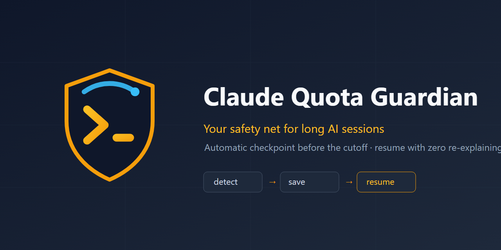

<p align="center"></p>

# 🛡️ Claude Quota Guardian

> 🇪🇸 [Versión en español](README.md)

**Your safety net for long AI sessions.** Guardian watches your **real Claude account quota** in the background (5h session, weekly, and per-model limits) and, right before the cutoff, forces a structured checkpoint that the next session resumes on its own — no lost thread, no re-explaining. It ships with a **browser extension** to watch your usage live.

## The problem

Anyone who runs long sessions with an AI agent knows the moment: you're hours into building something, your plan quota runs out, and the session dies mid-task. What follows is worse than the cutoff itself: reopening, re-explaining everything from scratch, and watching the agent retry approaches that had already failed.

## What Guardian does

When a **Claude Code terminal session** approaches your **real plan limit**, Guardian:

1. **Reads your real quota** (the same you see in Settings → Usage), not an estimate. Through your account's usage endpoint it gets all three windows: **Session (5h)**, **Weekly (all models)** and **per-model limits** (e.g. Fable). The block is driven by whichever account-wide window is closest to its cap (session or weekly); per-model limits are **advisory only** (if one model is spent, you keep working with another).
2. **Stops new work** with a real tool block (`PreToolUse` hook): the agent cannot keep burning quota without saving first. It applies to the terminal sessions that are over the threshold (the one that tripped it and any other that crosses it later); other sessions — e.g. Desktop or SDK routines — are not stopped. If you never save the checkpoint, the block lifts on its own once your real quota is back under the threshold, or earlier with `/guardian-continue`.
3. **Forces a structured checkpoint** (`/continuity-checkpoint`): what was being built, what worked (with evidence), what did NOT work and why, the state of every file touched, decisions made, and the exact next step. It's written **dense** (caveman style: no filler, fragments; identifiers/paths/errors kept intact) so reopening spends the fewest possible tokens re-reading it.
4. **Notifies you when the quota resets** (background watcher with OS notifications and adaptive polling — 15→3→1 min as your account fills up).
5. **Resumes on its own**: the next time you open Claude Code in that project, a `SessionStart` hook injects the full checkpoint as context (only the one `/continuity-checkpoint` saves in the project's continuity folder; a file anywhere else, e.g. a CHECKPOINT.md inside the repo, is not auto-loaded: you are shown its path to decide). The agent announces the next step and continues — zero re-explanation.
6. **Shows how long the conversation cache has left**, in three places: the status line, a bar above the prompt (with a **Traspaso** (handoff) button) and the browser extension. Once the cache expires, the next message pays for the whole context again. Details below.

```
[Normal work] -> PostToolUse: check-usage.js
       |
       |-- quota below threshold -> no-op
       |
       `-- Session/Weekly >= threshold -> pending.json + OS notification + block
                        |
                        v
                Claude runs /continuity-checkpoint
                -> writes checkpoint-<ts>.md
                -> ends the turn cleanly
                        |
              (you close Claude; quota resets later)
                        |
              quota-watcher (background) detects the reset
              -> notification: "ready to continue"
                        |
              You reopen Claude in the same project
                        |
                SessionStart: resume-context.js
                -> injects the full checkpoint
                        |
                Claude announces the next step and continues
```

No automatic relaunching: you decide when to reopen. Guardian only handles the save and the resume.

## How does Guardian save you tokens?

In four ways, and the newest one is the one you feel most in long sessions: **knowing when the cache expires**.

After each message, Claude caches the start of the conversation. While that cache is alive, the next message reads the whole context at a fraction of the price: per [Anthropic's documentation](https://platform.claude.com/docs/en/build-with-claude/prompt-caching), a cache read costs 10% of the normal input price (5% on Opus 5.5 and Sonnet 5.5, 2.5% on Fable 5.1). Once it expires, the next message pays for the full context again, and writing it back to the cache costs 1.25x the normal price (5-minute cache) or 2x (1-hour cache).

Say a session holds 150k tokens of context: with the cache alive, your message reads them at cache price; expired, it pays for all of them. Nothing in Claude Code tells you when that happens.

1. **Cache countdown + Handoff.** You see the minutes left. If you are about to step away for longer than that, press **Traspaso** (handoff): Guardian saves the checkpoint, you clear the session and carry on with a small context instead of paying for the big one again.
2. **Dense checkpoint.** The checkpoint is written with no filler (fragments; paths, errors and identifiers intact), so resuming costs few tokens and you re-explain nothing.
3. **Block before the cutoff.** The agent does not keep spending quota on a session that is about to die mid-task.
4. **Downgrade nudge.** When your quota enters the risk band (85% by default) and you are on a premium model, Guardian suggests a cheaper one to stretch it. It only suggests; it never switches the model for you.

**How long the cache lasts.** The API default is 5 minutes, and there is a 1-hour cache. Guardian estimates 60 minutes when your session reports a subscription quota (Pro/Max) and 5 when it does not (API key). If your case differs, pin it with `cache.ttlMinutes` ([docs/configuration.md](docs/configuration.md)). It is an estimate: the clock counts from your last saved message, while the cache counts from the start of the request. That is why it warns you 5 minutes early.

The idea came from a "token-saving kit" shared as an artifact. I audited it, kept the clock, and wired it to the checkpoint Guardian already had, so the button actually does the handoff instead of only warning you.

### Where you see the countdown

| Where | What you see | How it turns on |
|---|---|---|
| **Status line** | `cache 42m`, `cache 3m!` at 5 minutes or less, `cache expired` | Guardian's own line, when the installer could claim the `statusLine` slot (refreshes every 30 s) |
| **Bar above the prompt** | Live cache, context, 5h, week, a **Traspaso** (handoff) button and then **Limpiar y seguir** (clear and continue) | `node bin/install.js` turns it on; as a plugin: `quota-guardian-bar` |
| **Browser extension** | One row per Claude Code session of the last 24 h, with the minutes left | `node bin/install.js` registers the local bridge; reload the extension |

The bar and the extension speak Spanish today, like Guardian's other messages.

## Browser extension (usage monitor)

`extension/` contains a **Manifest V3** extension (Chrome/Edge/Brave) to **watch your usage live** without opening Settings:

- **Toolbar badge**: the % of the most-pressing window (session or weekly), colored green/orange/red by how close it is to the cap. Refreshed in the background.
- **Popup**: Session (5h) and Weekly as the main bars; per-model limits (Fable, etc.) as advisory; a reset countdown for each window.
- **Dollar credits** (e.g. the promotional credit for cloud sessions): used, remaining and expiry. Informational only: never in the badge or the block. From the terminal: `node scripts/credits.js`.
- **Claude Code cache**: how long the cache of each Claude Code session of the last 24 h has left, green, orange at 5 minutes or less, red once expired.
- **No tokens, no secrets**: it uses the same call the Claude app's own Usage screen makes, authenticated with your existing claude.ai session cookies. Only host permission: `claude.ai`. It sends nothing to third parties.
- **The cache is read on your machine, not online**: a browser cannot read files, so `node bin/install.js` registers a small local program (native messaging) that only this extension can start. It reads Guardian's state files and answers with project names and minutes. Never paths, never the content of your conversations.

Install: `chrome://extensions` → Developer mode → **Load unpacked** → the `extension/` folder. If you already had it, remove it and load it again: version 1.1 pins its ID so the local bridge recognizes it. Details in [extension/README.md](extension/README.md).

## Benefits (verifiable)

- **Real signal, not an estimate**: reads your account-wide quota (5h session / weekly / per-model) — the same number your account shows. The block fires on what will actually cut you off.
- **The 5h session — the fastest to deplete — is watched explicitly**, not as a side effect.
- **Zero lost context**: the checkpoint captures what automatic summaries lose — the approaches that failed and why, so they aren't retried.
- **Zero quota burned blindly**: the hard block prevents the agent from continuing work on a doomed session.
- **You know when the next message is going to be expensive**: the cache countdown tells you how many minutes are left before you pay for the whole context again, and the Traspaso (handoff) button lets you start clean in one click.
- **It never leaves you stuck**: if you close without saving the checkpoint, the block lifts on its own once your real quota is back under the threshold. No timer, nothing to remember. And if you need to keep going for a while at your own risk, `/guardian-continue` lifts it.
- **Your automated routines keep running**: it only stops the terminal sessions that are at the limit. Whatever runs in Desktop or through the SDK is left alone.
- **One quota check per account**: all your projects share the same reading, and if the endpoint fails, Guardian waits (2, 4, 8… up to 15 min) instead of hammering it. I learned this the hard way: the previous version checked so often that the endpoint answered 429 for hours.
- **Safe resume**: only the checkpoint Guardian saved in its own folder is loaded automatically. A file from the repo, or a link pointing outside, never becomes context: you see the path and you decide.
- **Opening an unknown repo runs nothing from that repo**: Guardian never launches programs from the project folder or looks them up by bare name.
- **A skewed clock or a damaged file won't switch protection off**: readings stamped in the future or with broken data are discarded.
- **Works on any plan and any OS**: auto-detects only the installing user's quota (Pro/Max/Team) by reading Claude Code's OAuth token — a file on Windows/Linux, the **Keychain on macOS**.
- **Visual monitor**: browser extension with badge + popup (above).
- **One-command install, clean uninstall**: merges its hooks into `settings.json` without touching yours; the uninstaller only removes its own.
- **349 tests**: 333 with `npm test`, run in CI on Windows, macOS and Linux across Node 18 and 20, and 16 for the bar with `claude plugin test bar`.
- **Extensible to other AI providers**: adapter architecture; ships with notify-only monitoring of **OpenAI Codex CLI** today.

## Who is it for?

- **Claude Code users on Pro/Max/Team plans** who hit the 5h window during intense sessions.
- **Developers running autonomous agents** on long tasks (refactors, audits, multi-file features) where a mid-task cutoff costs hours.
- **Freelancers and small teams** who bill for outcomes and can't afford re-explaining context every session.
- **Multi-CLI users** who alternate between Claude Code and Codex and want a single safety net.

## Honest scope

- The full loop (detect → block → checkpoint → auto-resume) applies to **Claude Code in the terminal** (`entrypoint === "cli"`), the only surface with hooks and a real "end the turn" affordance. **Claude Code Desktop** gets the notify-only tier: warnings, never a block.
- Other providers (Codex today) are **notify-only**: without a hook system there is no blocking and no auto-resume — Guardian warns you in time to ask for a summary before the cutoff.
- Blocking is **100% driven by your real quota** by default. The local context % is measured and displayed but does not block unless you opt in as a fallback (useful when no quota signal exists — see [docs/configuration.md](docs/configuration.md)).
- Quota detection requires being logged into Claude Code with a Pro/Max/Team account (OAuth token). With a bare API key there are no session/weekly windows to watch.
- **Connections it makes**: your own account's usage endpoint at `api.anthropic.com` (with your token, only to read your quota) and Telegram if you turn those notifications on. If you configure `plan` to use ccusage, `npx` may download it from npm. The extension, separately, only talks to `claude.ai` from your browser, and to the local cache bridge, which uses no network. Your code never leaves your machine.
- **The cache clock is an estimate**: Anthropic does not expose when it expires. Guardian counts from your last saved message with the lifetime that matches your account type (or the one you pin).

## Requirements

- Node.js >= 18
- Claude Code (CLI) with hook support

## Install

### Option A — As a Claude Code plugin (1 command)

```
/plugin install quota-guardian --marketplace LeonardoIAConsult/claude-quota-guardian
/plugin install quota-guardian-bar --marketplace LeonardoIAConsult/claude-quota-guardian
```

The first line loads the four hooks + the `/continuity-checkpoint` command: the core loop (detect → block → checkpoint → auto-resume). The second, optional, adds the cache-countdown bar above the prompt. It needs Claude Code 2.1.275 or later. The **quota-reset watcher** (notifies while Claude is closed) and the cache bridge for the extension are exclusive to Option B. Details: [docs/plugin-packaging.md](docs/plugin-packaging.md).

> If you installed it before as `claude-quota-guardian@claude-quota-guardian`: Claude Code no longer accepts third-party plugins whose name starts with `claude-`, so it is now called `quota-guardian`. Remove the old one with `/plugin uninstall claude-quota-guardian@claude-quota-guardian` and install with the line above.

### Option B — Standalone (full feature set)

```bash
git clone <repo-url> ~/.claude/claude-quota-guardian
cd ~/.claude/claude-quota-guardian
npm install
node bin/install.js
```

That single command: writes the default config, merges the hooks into `~/.claude/settings.json` (without overwriting yours), claims the `statusLine` slot for quota tracking and the cache countdown (only if free), installs the `/continuity-checkpoint` command, registers the watcher with your OS scheduler, turns on the cache bar above the prompt (from the next session) and registers the local bridge so the browser extension can see the cache (Chrome, Edge, Brave and Chromium).

### Uninstalling

```bash
node bin/uninstall.js          # removes hooks, command, watcher, bar and bridge
node bin/uninstall.js --purge  # also deletes saved checkpoints
```

### Testing your install

```bash
node scripts/simulate-threshold.js --pct 99.7
```

Prints a ready-to-run command that simulates a near-limit session and confirms the hook fires, without waiting for a real session to fill up.

## Configuration

Everything is optional with sensible defaults: thresholds, plan, watcher cadence, `blockOnContext` (context fallback), per-model warning, cache lifetime and warning (`cache`), external providers. See [docs/configuration.md](docs/configuration.md).

## What's included

- **Core loop** — `hooks/check-usage.js` (quota detection), `hooks/enforce-checkpoint.js` (real blocking), `hooks/resume-context.js` (auto-resume). Terminal surface only.
- **Real quota reading** — `lib/usage-api.js`: account-wide quota (session/weekly/per-model) from your account's usage endpoint; OAuth token from a file or the macOS Keychain.
- **Cache countdown** — `lib/cache-clock.js` (the rule), `hooks/statusline.js` (status line), `bar/` (bar above the prompt, plugin `quota-guardian-bar`).
- **Browser extension** — `extension/`: usage monitor (badge + popup) + per-session cache through the local bridge `native-host/`.
- **Background watcher** — `watcher/quota-watcher.js`: quota-reset notification + adaptive cadence.
- **Provider adapters** — `lib/adapters/codex.js`: notify-only monitoring of OpenAI Codex CLI sessions.
- **Installer / uninstaller** — `bin/install.js` / `bin/uninstall.js`.

## License

MIT

---

Built and maintained by [Leonardo Antolínez](https://www.leonardoantolinez.com). Last updated: October 19, 2026 (v1.1, cache countdown).
