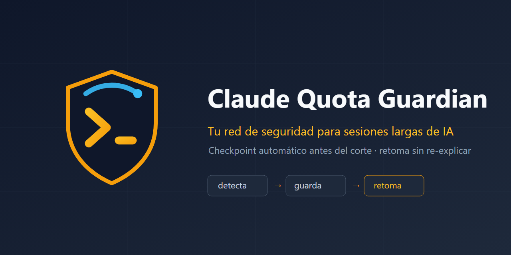

<p align="center"></p>

# 🛡️ Claude Quota Guardian

> 🇬🇧 [English version](README.en.md)

**Tu red de seguridad para sesiones largas de IA.** Guardian vigila en segundo plano la **cuota real de tu cuenta de Claude** (sesión de 5h, límite semanal y por-modelo) y, justo antes del corte, obliga a guardar un checkpoint estructurado que la próxima sesión retoma sola — sin perder el hilo, sin re-explicar nada. Incluye una **extensión de navegador** para ver tu consumo en vivo.

## El problema

Cualquiera que trabaje sesiones largas con un agente de IA conoce el momento: llevas horas construyendo algo, la cuota del plan se agota, y la sesión muere a mitad de una tarea. Lo que sigue es peor que el corte: reabrir, re-explicar todo desde cero, y ver al agente re-intentar caminos que ya habían fallado.

## Qué hace Guardian

Cuando una **sesión de Claude Code en terminal** se acerca al límite **real de tu plan**, Guardian:

1. **Lee tu cuota real** (la misma que ves en Ajustes → Uso), no una estimación. Vía el endpoint de uso de tu cuenta obtiene las tres ventanas: **Sesión (5h)**, **Semanal (todos los modelos)** y los **límites por modelo** (p. ej. Fable). El bloqueo lo gobierna la ventana que gatea todo (sesión o semanal); los límites por modelo **solo avisan** (si se agota un modelo, sigues con otro).
2. **Frena el trabajo nuevo** con un bloqueo real de herramientas (hook `PreToolUse`): el agente no puede seguir quemando cuota sin guardar primero. Aplica a las sesiones de terminal que están sobre el umbral (la que lo disparó y cualquier otra que lo cruce después); otras sesiones — p. ej. rutinas en Desktop o vía SDK — no se frenan. Si no guardas el checkpoint, el bloqueo se levanta solo cuando tu cuota real vuelve bajo el umbral, o antes con `/guardian-continue`.
3. **Fuerza un checkpoint estructurado** (`/continuity-checkpoint`): qué se estaba construyendo, qué funcionó (con evidencia), qué NO funcionó y por qué, estado de cada archivo, decisiones tomadas, y el próximo paso exacto. Se escribe **denso** (estilo caveman: sin relleno, fragmentos; identificadores/rutas/errores intactos) para gastar los mínimos tokens al reabrir.
4. **Avisa cuando la cuota se reinicia** (watcher en segundo plano con notificaciones del sistema, cadencia adaptativa 15→3→1 min según qué tan llena está la cuenta).
5. **Retoma solo**: al reabrir Claude Code en ese proyecto, un hook `SessionStart` inyecta el checkpoint completo como contexto (solo el que `/continuity-checkpoint` guarda en la carpeta de continuidad del proyecto; un archivo en otra ruta, p. ej. un CHECKPOINT.md dentro del repo, no se carga solo: se te muestra la ruta para que decidas). El agente anuncia el próximo paso y sigue — cero re-explicación.
6. **Te muestra cuánto le queda al caché** de la conversación, en tres sitios: la barra de estado, una barra encima del prompt (con botón de **Traspaso**) y la extensión del navegador. Cuando el caché vence, el siguiente mensaje vuelve a pagar todo el contexto. Detalle abajo.

```
[Trabajo normal] -> PostToolUse: check-usage.js
       |
       |-- cuota bajo el umbral -> no-op
       |
       `-- Sesión/Semanal >= umbral -> pending.json + notificación OS + bloqueo
                        |
                        v
                Claude ejecuta /continuity-checkpoint
                -> escribe checkpoint-<ts>.md
                -> cierra el turno limpio
                        |
              (cierras Claude; la cuota se reinicia después)
                        |
              quota-watcher (fondo) detecta el reset
              -> notificación: "listo para continuar"
                        |
              Reabres Claude en el mismo proyecto
                        |
                SessionStart: resume-context.js
                -> inyecta el checkpoint completo
                        |
                Claude anuncia el próximo paso y sigue
```

Sin relanzamiento automático: tú decides cuándo reabrir. Guardian solo se encarga del guardado y la retoma.

## ¿Cómo te ahorra tokens Guardian?

Te ahorra tokens de cuatro formas, y la más nueva es la que más se nota en sesiones largas: **saber cuándo vence el caché**.

Claude guarda en caché el inicio de la conversación después de cada mensaje. Mientras ese caché vive, el siguiente mensaje lee todo el contexto a una fracción del precio: según la [documentación de Anthropic](https://platform.claude.com/docs/en/build-with-claude/prompt-caching), una lectura de caché cuesta el 10 % del precio normal de entrada (el 5 % en Opus 5.5 y Sonnet 5.5, el 2,5 % en Fable 5.1). Cuando vence, el siguiente mensaje paga el contexto completo otra vez, y volver a escribirlo en caché cuesta 1,25 veces el precio normal (caché de 5 min) o 2 veces (caché de 1 hora).

Pongamos una sesión con 150k tokens de contexto: con el caché vivo, tu mensaje los lee a precio de caché; vencido, los paga enteros. Y nada en Claude Code te avisa de cuándo pasa.

1. **Cuenta regresiva del caché + Traspaso.** Ves los minutos que quedan. Si vas a parar más tiempo del que le queda, pulsas **Traspaso**: Guardian guarda el checkpoint, limpias la sesión y sigues con un contexto pequeño en vez de volver a pagar el grande.
2. **Checkpoint denso.** El checkpoint se escribe sin relleno (fragmentos; rutas, errores e identificadores intactos), así que retomar cuesta pocos tokens y no tienes que re-explicar nada.
3. **Bloqueo antes del corte.** El agente no sigue gastando cuota en una sesión que va a morir a mitad de tarea.
4. **Aviso de bajar de modelo.** Cuando tu cuota entra en la franja de riesgo (85 % por defecto) y estás en un modelo premium, Guardian te sugiere uno más barato para estirarla. Solo avisa, nunca cambia el modelo por ti.

**Cuánto dura el caché.** Por defecto la API usa 5 minutos, y hay un caché de 1 hora. Guardian estima 60 minutos cuando tu sesión reporta cuota de suscripción (Pro/Max) y 5 cuando no (API key). Si tu caso es otro, lo fijas con `cache.ttlMinutes` ([docs/configuration.md](docs/configuration.md)). Es una estimación: el reloj cuenta desde tu último mensaje guardado, y el caché cuenta desde el inicio de la petición. Por eso te avisa con 5 minutos de margen.

La idea me llegó de un "kit de ahorro de tokens" que circulaba como artifact. Lo audité, me quedé con el reloj y lo conecté al checkpoint que Guardian ya tenía, para que el botón haga el traspaso de verdad y no solo te avise.

### Dónde ves la cuenta regresiva

| Dónde | Qué ves | Cómo se activa |
|---|---|---|
| **Barra de estado** | `cache 42m`, `cache 3m!` cuando quedan 5 min o menos, `cache expired` | La de Guardian, si el instalador pudo reclamar el `statusLine` (se refresca cada 30 s) |
| **Barra encima del prompt** | Caché en vivo, contexto, 5 h, semana, botón **Traspaso** y luego **Limpiar y seguir** | `node bin/install.js` la activa sola; como plugin: `quota-guardian-bar` |
| **Extensión del navegador** | Una fila por cada sesión de Claude Code de las últimas 24 h, con los minutos que quedan | `node bin/install.js` registra el puente local; recarga la extensión |

## Extensión de navegador (monitor de consumo)

En `extension/` hay una extensión **Manifest V3** (Chrome/Edge/Brave) para **ver tu consumo en vivo** sin abrir Ajustes:

- **Insignia (badge)** en la barra: el % de la ventana más apretada (sesión o semanal), en verde/naranja/rojo según cercanía al tope. Se actualiza en segundo plano.
- **Popup**: Sesión (5h) y Semanal como barras principales; los límites por modelo (Fable, etc.) como aviso; cuenta regresiva de reinicio de cada ventana.
- **Créditos en dólares** (por ejemplo, el crédito promocional para sesiones en la nube): cuánto usaste, cuánto te queda y cuándo vence. Es solo informativo: no cuenta para la insignia ni para el bloqueo. Desde la terminal: `node scripts/credits.js`.
- **Caché de Claude Code**: cuánto le queda al caché de cada sesión de Claude Code de las últimas 24 h, en verde, naranja cuando quedan 5 minutos o menos, y rojo cuando venció.
- **Sin tokens ni secretos**: usa la misma llamada que la pantalla de Uso de la propia app de Claude, autenticada con las cookies de tu sesión de claude.ai. Único permiso de host: `claude.ai`. No envía datos a terceros.
- **El caché se lee en tu equipo, no en internet**: el navegador no puede leer archivos, así que `node bin/install.js` registra un pequeño programa local (native messaging) que solo esta extensión puede abrir. Lee los archivos de estado de Guardian y responde nombres de proyecto y minutos. Nunca rutas, nunca el contenido de tus conversaciones.

Instalar: `chrome://extensions` → Modo desarrollador → **Cargar descomprimida** → carpeta `extension/`. Si ya la tenías, quítala y vuelve a cargarla: la versión 1.1 fija su ID para que el puente local la reconozca. Detalle en [extension/README.md](extension/README.md).

## Beneficios (comprobables)

- **Señal real, no estimada**: lee la cuota account-wide de tu cuenta (sesión 5h / semanal / por-modelo) — el mismo número que ves en la app. El bloqueo se dispara por lo que de verdad te va a cortar.
- **La sesión de 5h — la que más rápido se agota — se vigila explícita**, no como efecto secundario.
- **Cero contexto perdido**: el checkpoint captura lo que un resumen automático pierde — los caminos que fallaron y por qué, para que no se re-intenten.
- **Cero cuota quemada a ciegas**: el bloqueo duro impide que el agente siga trabajando sobre una sesión condenada.
- **Sabes cuándo el próximo mensaje va a salir caro**: la cuenta regresiva del caché te dice cuántos minutos quedan antes de volver a pagar todo el contexto, y el botón Traspaso te deja empezar limpio en un clic.
- **No te deja trabado**: si cierras sin guardar el checkpoint, el bloqueo se suelta solo cuando tu cuota real vuelve bajo el umbral. No depende de un reloj ni de que te acuerdes de nada. Y si necesitas seguir un rato bajo tu riesgo, `/guardian-continue` lo levanta.
- **Tus rutinas automáticas siguen corriendo**: solo frena las sesiones de terminal que están en el límite. Lo que corre en Desktop o por SDK no se toca.
- **Una sola consulta de cuota por cuenta**: todos tus proyectos comparten la misma lectura, y si el endpoint falla, Guardian espera (2, 4, 8… hasta 15 min) en vez de insistir. Lo aprendí a la mala: la versión anterior consultaba tanto que el endpoint respondía 429 durante horas.
- **Retoma segura**: se carga automáticamente solo el checkpoint que Guardian guardó en su carpeta. Un archivo del repo, o un enlace que apunte afuera, nunca entra como contexto: ves la ruta y decides tú.
- **Abrir un repo desconocido no ejecuta nada de ese repo**: Guardian nunca lanza programas desde la carpeta del proyecto ni los busca por nombre suelto.
- **Un reloj desajustado o un archivo dañado no apagan la protección**: las lecturas con fecha futura o datos rotos se descartan.
- **Funciona para cualquier plan y cualquier OS**: detecta solo la cuota de quien lo instale (Pro/Max/Team) leyendo el token OAuth de Claude Code — archivo en Windows/Linux, **Keychain en macOS**.
- **Monitor visual**: extensión de navegador con badge + popup + caché de cada sesión (arriba).
- **Instalación de 1 comando, desinstalación limpia**: mergea sus hooks en `settings.json` sin tocar los tuyos; el uninstaller solo quita lo suyo.
- **332 tests**: 322 con `npm test`, que corren en CI en Windows, macOS y Linux sobre Node 18 y 20, y 10 de la barra con `claude plugin test bar`.
- **Extensible a otros proveedores de IA**: arquitectura de adaptadores; hoy incluye monitoreo notify-only de **OpenAI Codex CLI**.

## ¿Para quién es?

- **Usuarios de Claude Code con plan Pro/Max/Team** que chocan contra la ventana de 5h en sesiones intensas.
- **Devs que corren agentes autónomos** en tareas largas (refactors, auditorías, features multi-archivo) donde un corte a mitad de camino cuesta horas.
- **Freelancers y equipos pequeños** que facturan por resultado y no pueden pagar el costo de re-explicar contexto en cada sesión.
- **Usuarios multi-CLI** que alternan Claude Code y Codex y quieren una sola red de seguridad.

## Alcance honesto

- El loop completo (detectar → bloquear → checkpoint → retoma automática) aplica a **Claude Code en terminal** (`entrypoint === "cli"`), la única superficie con hooks y un "cierra el turno" real. **Claude Code Desktop** recibe el tier notify-only: avisos, nunca bloqueo.
- Otros proveedores (Codex hoy) son **notify-only**: sin sistema de hooks no hay bloqueo ni retoma automática — Guardian te avisa a tiempo para pedirle un resumen antes del corte.
- El bloqueo es **100% guiado por tu cuota real** por defecto. El % de contexto local se mide y se muestra, pero no bloquea salvo que lo actives como fallback (útil si no hay señal de cuota, ver [docs/configuration.md](docs/configuration.md)).
- La detección de cuota requiere estar logueado en Claude Code con una cuenta Pro/Max/Team (token OAuth). Con API key suelta no hay ventanas de sesión/semanal que vigilar.
- **Conexiones que hace**: el endpoint de uso de tu propia cuenta en `api.anthropic.com` (con tu token, solo para leer tu cuota) y Telegram si activas esas notificaciones. Si configuras `plan` para usar ccusage, `npx` puede descargarlo de npm. La extensión, aparte, solo habla con `claude.ai` desde tu navegador, y con el puente local del caché, que no usa la red. Tu código no sale de tu máquina.
- **El reloj del caché es una estimación**: Anthropic no expone cuándo vence. Guardian cuenta desde tu último mensaje guardado con la duración que corresponde a tu tipo de cuenta (o la que tú fijes).

## Requisitos

- Node.js >= 18
- Claude Code (CLI) con soporte de hooks

## Instalación

### Opción A — Como plugin de Claude Code (1 comando)

```
/plugin install quota-guardian --marketplace LeonardoIAConsult/claude-quota-guardian
/plugin install quota-guardian-bar --marketplace LeonardoIAConsult/claude-quota-guardian
```

La primera línea carga los cuatro hooks + el comando `/continuity-checkpoint`: el loop principal (detectar → bloquear → checkpoint → retoma). La segunda, opcional, agrega la barra con la cuenta regresiva del caché encima del prompt. Necesita Claude Code 2.1.275 o posterior. El **watcher de reinicio de cuota** (avisa con Claude cerrado) y el puente del caché para la extensión son exclusivos de la Opción B. Detalle: [docs/plugin-packaging.md](docs/plugin-packaging.md).

> Si lo instalaste antes como `claude-quota-guardian@claude-quota-guardian`: Claude Code ya no admite plugins de terceros cuyo nombre empiece por `claude-`, por eso ahora se llama `quota-guardian`. Desinstala el viejo con `/plugin uninstall claude-quota-guardian@claude-quota-guardian` e instala con la línea de arriba.

### Opción B — Standalone (set completo)

```bash
git clone <repo-url> ~/.claude/claude-quota-guardian
cd ~/.claude/claude-quota-guardian
npm install
node bin/install.js
```

Ese único comando: escribe la config por defecto, mergea los hooks en `~/.claude/settings.json` (sin pisar los existentes), reclama el `statusLine` para tracking de cuota y la cuenta regresiva del caché (solo si está libre), instala el comando `/continuity-checkpoint`, registra el watcher en el programador de tareas de tu OS, activa la barra del caché encima del prompt (desde la siguiente sesión) y registra el puente local para que la extensión del navegador vea el caché (Chrome, Edge, Brave y Chromium).

### Desinstalar

```bash
node bin/uninstall.js          # quita hooks, comando, watcher, barra y puente
node bin/uninstall.js --purge  # además borra los checkpoints guardados
```

### Probar la instalación

```bash
node scripts/simulate-threshold.js --pct 99.7
```

Imprime un comando listo para simular una sesión al límite y confirmar que el hook dispara, sin esperar a que una sesión real se llene.

## Configuración

Todo opcional, con defaults sensatos: umbrales, plan, cadencia del watcher, `blockOnContext` (fallback de contexto), aviso por modelo, duración y aviso del caché (`cache`), proveedores externos. Ver [docs/configuration.md](docs/configuration.md).

## Qué incluye

- **Loop principal** — `hooks/check-usage.js` (detección de cuota), `hooks/enforce-checkpoint.js` (bloqueo real), `hooks/resume-context.js` (retoma automática). Solo superficie terminal.
- **Lectura de cuota real** — `lib/usage-api.js`: cuota account-wide (sesión/semanal/por-modelo) del endpoint de uso de tu cuenta; token OAuth desde archivo o Keychain (macOS).
- **Cuenta regresiva del caché** — `lib/cache-clock.js` (la regla), `hooks/statusline.js` (barra de estado), `bar/` (barra encima del prompt, plugin `quota-guardian-bar`).
- **Extensión de navegador** — `extension/`: monitor de consumo (badge + popup) + caché de cada sesión vía el puente local `native-host/`.
- **Watcher en segundo plano** — `watcher/quota-watcher.js`: aviso de reset de cuota + cadencia adaptativa.
- **Adaptadores de proveedor** — `lib/adapters/codex.js`: monitoreo notify-only de sesiones de OpenAI Codex CLI.
- **Instalador / desinstalador** — `bin/install.js` / `bin/uninstall.js`.

## Licencia

MIT

---

Hecho y mantenido por [Leonardo Antolínez](https://www.leonardoantolinez.com). Última actualización: 19 de octubre de 2026 (v1.1, cuenta regresiva del caché).
